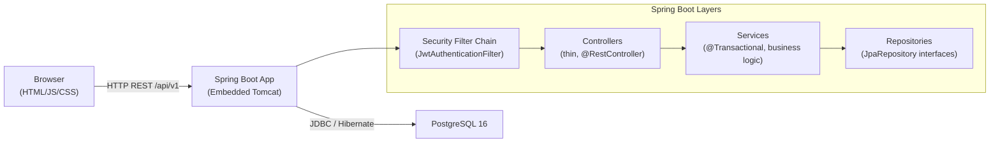

# Job Tracker

A full-stack web application for tracking job applications on an interactive Kanban board. Built with Java 21 and Spring Boot 3 as a portfolio project demonstrating production-quality engineering practices.

## Features

- **Authentication**: Register and log in with JWT (stateless, BCrypt hashed passwords)
- **Kanban Board**: Five columns — Wishlist, Applied, Interview, Offer, Rejected
- **Drag & Drop**: Move cards between columns using the native HTML5 drag-and-drop API
- **CRUD**: Create, view, edit, and delete job applications
- **Search & Filter**: Case-insensitive search by company or position; filter by status
- **Stats Bar**: Live application count per status for the current user
- **Ownership Isolation**: Each user sees only their own data (enforced at the service layer)
- **Dark Mode**: Automatically adapts to `prefers-color-scheme`
- **API Documentation**: Swagger UI at `/swagger-ui.html`

## Tech Stack

| Layer | Technology |
|---|---|
| Language | Java 21 |
| Framework | Spring Boot 3.3.5 |
| Security | Spring Security 6, stateless JWT (jjwt 0.12.6) |
| Persistence | Spring Data JPA, Hibernate 6, PostgreSQL 16 |
| Migrations | Flyway |
| Build | Apache Maven 3.9 |
| Frontend | HTML5, Tailwind CSS (CDN), Vanilla ES Modules |
| Docs | springdoc-openapi (Swagger UI) |
| Monitoring | Spring Boot Actuator |
| Testing | JUnit 5, Mockito, AssertJ, Testcontainers, Spring MockMvc |
| Coverage | JaCoCo |
| Containers | Docker (multi-stage), Docker Compose |
| CI | GitHub Actions |

## Architecture



**Package structure:**
```
com.jobtracker
├── config/          # SecurityConfig, OpenApiConfig
├── security/        # UserPrincipal, CustomUserDetailsService
│   └── jwt/         # JwtService, JwtAuthenticationFilter, JwtAuthenticationEntryPoint
├── user/
│   ├── controller/  # AuthController
│   ├── dto/         # RegisterRequest, LoginRequest, AuthResponse, UserSummaryResponse
│   ├── entity/      # User, Role
│   ├── repository/  # UserRepository
│   └── service/     # AuthService
├── application/
│   ├── controller/  # ApplicationController
│   ├── dto/         # Create/Update/StatusRequest, ApplicationResponse, StatsResponse
│   ├── entity/      # Application, ApplicationStatus
│   ├── mapper/      # ApplicationMapper
│   ├── repository/  # ApplicationRepository, StatusCountProjection
│   └── service/     # ApplicationService
└── common/
    ├── dto/         # ErrorResponse
    └── exception/   # GlobalExceptionHandler, custom exceptions
```

## API Overview

| Method | Path | Auth | Description |
|---|---|---|---|
| POST | `/api/v1/auth/register` | Public | Create account, returns JWT |
| POST | `/api/v1/auth/login` | Public | Login, returns JWT |
| GET | `/api/v1/auth/me` | Bearer | Current user profile |
| GET | `/api/v1/applications` | Bearer | List (paginated, filtered, searched) |
| POST | `/api/v1/applications` | Bearer | Create application (201) |
| GET | `/api/v1/applications/{id}` | Bearer | Get by ID (404 if not owned) |
| PUT | `/api/v1/applications/{id}` | Bearer | Full update |
| PATCH | `/api/v1/applications/{id}/status` | Bearer | Update status (Kanban move) |
| DELETE | `/api/v1/applications/{id}` | Bearer | Delete (204, 404 if not owned) |
| GET | `/api/v1/applications/stats` | Bearer | Count per status |
| GET | `/actuator/health` | Public | Health check |
| GET | `/swagger-ui.html` | Public | Swagger UI |

**Query params for `GET /api/v1/applications`:**
- `status` — filter by `WISHLIST`, `APPLIED`, `INTERVIEW`, `OFFER`, `REJECTED`
- `search` — case-insensitive match on company or position
- `page`, `size`, `sort` — standard Spring Data pagination

## How to Run

### Option 1: Docker Compose (recommended)

```bash
# 1. Copy the environment template
cp .env.example .env

# 2. (Optional) edit .env to change secrets or ports

# 3. Start everything
docker compose up --build

# App: http://localhost:8080
# Swagger UI: http://localhost:8080/swagger-ui.html
```

### Option 2: Local Development

**Prerequisites:** Java 21, Maven 3.9+, a running PostgreSQL 16 instance.

```bash
# 1. Create database
psql -c "CREATE USER jobtracker WITH PASSWORD 'jobtracker';"
psql -c "CREATE DATABASE jobtracker OWNER jobtracker;"

# 2. Copy and configure env
cp .env.example .env
# (edit DB_HOST, DB_USER, DB_PASSWORD as needed)

# 3. Run the app (local profile uses .env values or defaults)
./mvnw spring-boot:run

# App: http://localhost:8080
```

## How to Run Tests

```bash
# Unit tests only (no Docker required)
./mvnw test -Dtest="AuthServiceTest,ApplicationServiceTest"

# All tests (integration tests use H2 in-memory when Docker is unavailable)
./mvnw verify

# Generate JaCoCo coverage report
./mvnw verify jacoco:report
# Report: target/site/jacoco/index.html
```

## Project Structure

```
.
├── .github/workflows/ci.yml       # GitHub Actions CI
├── src/main/java/com/jobtracker/  # Application source
├── src/main/resources/
│   ├── application.yml            # Base configuration
│   ├── application-local.yml      # Local profile (PostgreSQL)
│   ├── application-prod.yml       # Production profile
│   ├── db/migration/              # Flyway SQL migrations
│   └── static/                    # Frontend (HTML/JS/CSS)
├── src/test/java/com/jobtracker/  # Tests
├── .env.example                   # Environment variable template
├── docker-compose.yml             # App + PostgreSQL compose
├── Dockerfile                     # Multi-stage build
└── pom.xml                        # Maven build descriptor
```

## Key Design Decisions

### Stateless JWT Authentication
The API is fully stateless. The `JwtAuthenticationFilter` intercepts every request, validates the `Authorization: Bearer <token>` header using `JwtService` (backed by HMAC-SHA384), and populates the `SecurityContext` for the current thread. No sessions or cookies are used. Expiry is configurable via `app.jwt.expiration-ms`.

### Flyway Migrations
`ddl-auto` is always set to `validate` — Hibernate never creates or alters tables. All schema changes live in versioned SQL files in `src/main/resources/db/migration/`. This makes schema evolution auditable, reversible (with undo scripts), and safe in production.

### Ownership Checks
Every service method that touches an `Application` entity calls `findByIdAndUserId(id, userId)`. If the record exists but belongs to a different user, the method returns `Optional.empty()`, and the service throws `ResourceNotFoundException` (404). This intentionally does not distinguish "not found" from "forbidden" to avoid leaking resource existence to unauthorized callers.

### DTO Mapping
Entities are never exposed directly from controllers. `ApplicationMapper` (a plain Spring `@Component`) converts between `Application` and `ApplicationResponse`. Input is validated by Bean Validation before it reaches the service. The `GlobalExceptionHandler` translates every exception into a consistent JSON error body.

### Testing Strategy
- **Unit tests** (Mockito): `AuthServiceTest`, `ApplicationServiceTest` — 18 tests covering all happy paths and failure cases without a database.
- **Integration tests** (Spring MockMvc + H2/Testcontainers): `AuthIntegrationTest`, `ApplicationCrudIntegrationTest`, `ApplicationQueryIntegrationTest`, `ApplicationValidationIntegrationTest` — 23 tests covering the full HTTP stack including auth, pagination, ownership, and validation.

## Screenshots

> _Add screenshots here after running the application._

| Login | Register | Kanban Board |
|---|---|---|
| _screenshot_ | _screenshot_ | _screenshot_ |

| Add/Edit Modal | Dark Mode |
|---|---|
| _screenshot_ | _screenshot_ |
